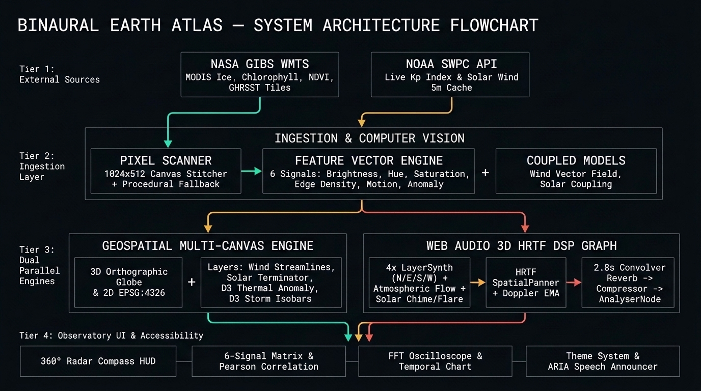
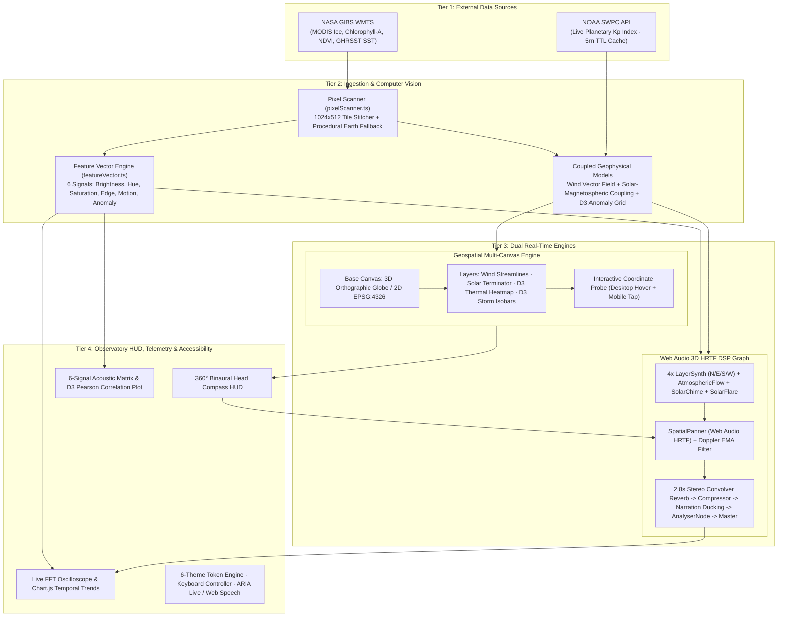

# Binaural Earth Atlas — System Design

**Binaural Earth Atlas (BEA)** is a client-computed planetary observation and real-time 3D binaural sonification Single-Page Application (SPA) built with **React 19**, **TypeScript**, **Vite**, **Tailwind CSS v4**, **D3 v7**, **Chart.js**, **TopoJSON (`world-atlas`)**, and the **Web Audio API**.

---

## 1. System Architecture Flowchart



### Mermaid Pipeline View



---

## 2. Architectural Style & Core Principles

Because satellite pixel scanning, D3 pressure contour generation, and real-time HRTF spatial audio require deterministic sub-frame latency and raw pixel array (`ImageData`) access, BEA runs as a **zero-backend, browser-native scientific instrument**:

- **Zero Server Bottlenecks:** Satellite raster analysis, geospatial projection math, and DSP synthesis run directly in-browser, eliminating backend round-trips while scrubbing months (`2007`, `2025`, `2026`), orbiting the 3D globe, or rotating listening heading.
- **Offline-First Graceful Degradation:** External endpoints (NASA GIBS WMTS and NOAA SWPC) include timeouts, secondary layer fallbacks, and deterministic procedural models so the observatory remains fully functional offline or behind strict CORS environments.
- **Paired State + Ref Architecture:** `App.tsx` mirrors critical real-time values (`isPlaying`, `vectors`, `archiveYear`, `activeLayerKey`) into React refs alongside state so `setInterval` archive sequencers and `requestAnimationFrame` audio/canvas loops never suffer from stale closures.

---

## 3. Subsystem Breakdown

### 3.1 Ingestion & Computer Vision Layer (`src/analysis/`)

| Module | Responsibility | Key Contracts & Limits |
| :--- | :--- | :--- |
| `pixelScanner.ts` | Fetches `3×2` WMTS tiles (`epsg4326`, matrix `1`, `512px`), stitches and crops to standardized `1024×512` offscreen canvases; caches frames in-memory and falls back to `fallbackLayerId` or TopoJSON-driven `Procedural Earth Model`. | `ANALYSIS_WIDTH = 1024`, `ANALYSIS_HEIGHT = 512`, `GIBS_ENDPOINT` |
| `featureVector.ts` | Scans `ImageData` pixels for each cardinal stream to compute normalized `[0, 1]` telemetry (`brightness`, `hue`, `saturation`, `edgeDensity`, `motion`, `climateAnomaly`). | `FeatureVector` per `LayerKey` (`north`, `east`, `south`, `west`) |
| `windVectorField.ts` | Computes synoptic surface wind speeds (`m/s`) and bearings across lat/lon grids from SST thermal gradients, Coriolis regimes, and heading telemetry. | `WindVectorField`, `sampleWindAlongHeading` |
| `solarActivity.ts` | Polls NOAA SWPC live planetary `Kp` JSON with a `3.5s` abort guard and `5 min` TTL cache, falling back to a deterministic solar-magnetospheric coupling model (`kpIndex`, `solarWindKms`, `auroralPotentialPct`). | `fetchLiveSolarKp`, `computeSolarActivityTelemetry` |
| `climateAnomalyHeatmap.ts` | Generates diverging temperature variance fields (`ΔT °C`, `-3.5°C` to `+3.5°C`) and statistical summaries (`meanC`, `maxC`, `minC`). | `ANOMALY_MIN_C`, `ANOMALY_MAX_C` |

#### Cardinal Satellite-to-Audio Mapping (`src/types/bea.ts`)

| Cardinal Azimuth | Domain | NASA GIBS Primary Layer | Waveform | 3D Coordinates |
| :--- | :--- | :--- | :--- | :--- |
| **North (`000°`)** | Cryosphere (Sea Ice) | `MODIS_Terra_Sea_Ice` | `triangle` | `(0, 0, -2)` |
| **East (`090°`)** | Hydrosphere (Chlorophyll-A) | `MODIS_Aqua_L2_Chlorophyll_A` | `sine` | `(2, 0, 0)` |
| **South (`180°`)** | Thermal (Sea Surface Temp) | `GHRSST_L4_MUR_Sea_Surface_Temperature` | `sawtooth` | `(0, 0, 2)` |
| **West (`270°`)** | Biosphere (Vegetation NDVI) | `MODIS_Terra_NDVI_8Day` / Monthly | `triangle` | `(-2, 0, 0)` |

---

### 3.2 Geospatial Rendering Engine (`src/components/SatelliteMapCanvas.tsx` & `src/geo/`)

Uses a **stacked multi-canvas viewport** sized dynamically via `ResizeObserver` for device-pixel-ratio clarity:

1. **Base Map Canvas (`#orbital-globe` / `#satellite-map`):**
   - Renders either an interactive **3D Orthographic Globe** (drag-to-rotate with pointer capture and `touch-action: none`) or a **2:1 `EPSG:4326` Plate Carrée** canvas.
   - Composites optional **D3 Climate Anomaly Heatmap** (`RdBu` diverging ramp) and **UTC Solar Terminator** shadow bands (`solarTerminator.ts`: `0°` Horizon + `-6°` Civil Twilight + subsolar coordinates).
2. **Wind Streamline Canvas (`windFlowOverlay.ts`):**
   - `requestAnimationFrame` animated particle streamlines color-coded by velocity stops.
3. **D3 Storm Radar Isobar Canvas (`stormRadarOverlay.ts`):**
   - Real-time D3 pressure contours (`972 hPa`–`1012 hPa`) animating cyclonic storm cores scaled by `stormRadarIntensity` (`0.00×`–`2.00×`).
4. **Coordinate Telemetry Probe:**
   - Desktop mouse hover and mobile tap-to-probe (distinguishing taps from drags `>3px` on the 3D globe) display viewport-clamped telemetry tooltips: `LAT/LON`, `ANOMALY %`, `ΔT °C`, `LUM %`, `WIND m/s`, `STORM RADAR SLP (hPa)`, and `SOLAR REGIME`.

---

### 3.3 Real-Time Web Audio & Spatial DSP Graph (`src/audio/`)

Initialized lazily on user interaction inside a single Web Audio `AudioContext`:

```text
[LayerSynth x4 (N, E, S, W)] ---> [PannerNode (HRTF, inverse distance)] --+
  - Carrier Osc (scaled pitch)                                             |
  - Detuned Anomaly Osc (>2σ)                                              v
[AtmosphericFlowSynth (Granular Wind)] ------------------------------> [spatialBus]
[SolarChimeSynth (Auroral Surge)] & [SolarFlareSynth (Noise Sweep)] ------>+
                                                                           |
        +------------------------(Dry Path: Vacuum)------------------------+
        |                                                                  |
        |     +---> [ConvolverNode (2.8s Deterministic Stereo Planetary IR)]|
        |     |---> [Biquad Lowpass Tone Filter] ---> [wetGain: Atmos]     |
        v     |                                                            |
   [dryGain] <+------------------------------------------------------------+
        |
        v
[DynamicsCompressorNode] -> [narrationDuckGain] -> [AnalyserNode (FFT)] -> [masterGain] -> Out
```

- **6-Signal Sonification Rules (`layerSynth.ts`, `scales.ts`):**
  - `Brightness` → Octave/pitch register
  - `Hue` → Quantized degree within `Pentatonic`, `Dorian`, or `Harmonic` scales
  - `Saturation` → Biquad lowpass cutoff (`400–6000 Hz`)
  - `Edge Density` → Rhythmic pulse subdivision (`1× / 2× / 3×`)
  - `Motion` → Archive cadence (`1500–2500 ms`) & relativistic Doppler pitch shift
  - `Climate Anomaly` → Detuned harmonic tension oscillator blend
- **HRTF Spatialization (`spatialPanner.ts`):**
  - Supports **360° Smooth Pan** (circular-arc `requestAnimationFrame` listener slerp) and **Cardinal Snap** (`500ms` crossfades between N/E/S/W).
- **Doppler Shift Telemetry (`audioEngine.ts`):**
  - Computes signed shift $f' = \frac{f}{1 - v/c}$ from per-layer frame motion velocity, frame-to-frame motion delta, sequencer speed, and user `dopplerSensitivity` (`0.00×–3.00×`), smoothed through an exponential moving average ($\alpha = 0.28$).
- **Automated Event Detection:**
  - Logs `AudioEventEntry` records and triggers acoustic cues when thresholds trip:
    - `ANOMALY_SPIKE_THRESHOLD = 0.44`
    - `HIGH_MOTION_THRESHOLD = 0.48`
    - `SOLAR_ACTIVITY_THRESHOLD = 0.68`
    - `SOLAR_WIND_FLARE_THRESHOLD_KMS = 680` (or spike delta $\ge 95\text{ km/s}$)

---

### 3.4 Observatory HUD, Visualization & Multi-Theme System (`src/components/`, `src/theme/`, `src/ui/`)

- **`RadarCompassHud.tsx`:** Interactive `280×280` canvas compass with `touch-none` pointer drag, Auto-Rotate (`5°/s`), Magnetic Snap (auto-locks toward peak anomaly centers), and Cardinal focus weight cards (`0.45×–1.00×`).
- **`AudioSpectrumBar.tsx`:** 60fps FFT spectrum/oscilloscope canvas bound to `AnalyserNode`.
- **`SignalCorrelationPlot.tsx`:** Real-time D3 scatter plot + linear regression computing Pearson $r$ between `Brightness` and `Climate Anomaly` across frames, with unified pointer tap/scrub inspection.
- **`TemporalTrendsChart.tsx`:** Chart.js monthly comparison curve of intensity vs. anomaly across the selected archive year (`2026`, `2025`, `2007`).
- **`src/theme/themes.ts`:**
  - Provides 6 high-contrast scientific palettes (`obsidian`, `aurora`, `amber`, `abyssal`, `solar-flare`, `night`) persisted in `localStorage`.
  - Updates `:root` CSS variables via `applyThemeCssVars` for DOM styling while passing structured RGB/hex canvas palettes directly to Canvas, SVG, D3, and Chart.js renderers.
  - Pressing `[N]` toggles Night Mode while preserving `lastStandardThemeRef` for round-trip restoration.
- **Accessibility & Mobile Responsiveness:**
  - Keyboard-first command layer (`useKeyboardControls.ts`: `Space`, `←/→`, `1–4`, `M/V/T/A/S/R/P/O/G/W/N`, `H`).
  - ARIA live region announcer (`ui/announcer.ts`) paired with optional Web Speech narration (`narrationDuckGain` automatically ducks master synth volume while speaking).
  - Responsive layout down to `360px` viewports: 2-column mobile header toolbar, mobile telemetry sub-row (`EPOCH | HDG | KP`), wrapping seasonal benchmarks, `44px` coarse-pointer slider targets, and `touch-none` canvases.

---

## 4. Architectural Trade-Offs & Future Scaling Paths

| Concern | Current Choice | Rationale | Future Scaling Path |
| :--- | :--- | :--- | :--- |
| **Satellite Processing** | Client-side WMTS stitching & pixel analysis | Zero server compute cost; works offline with procedural coastlines | Add a lightweight Edge/Express cache proxy (`server.ts`) to serve pre-computed multi-decade (`2002–2026`) JSON feature vectors. |
| **Compute Threading** | Main-thread `ImageData` scan & `AudioContext` nodes | Simple shared memory & zero worker serialization overhead | Offload pixel scanning to a **Web Worker** (`OffscreenCanvas`) and custom envelopes to an **AudioWorklet** if scaling past 4 spatial voices. |
| **Persistence** | `localStorage` for theme & onboarding state | Zero authentication friction and full privacy | Integrate optional Firebase/Cloud persistence for user-saved climate bookmarks, mission logs, and exported audio stems. |
| **State Orchestration** | Centralized React state + Ref mirrors in `App.tsx` | Single source of truth across synchronized audio/visual frames | Split into slice stores (e.g., `useAudioStore`, `useGeoStore`) if expanding into multi-pane or collaborative observatory sessions. |
