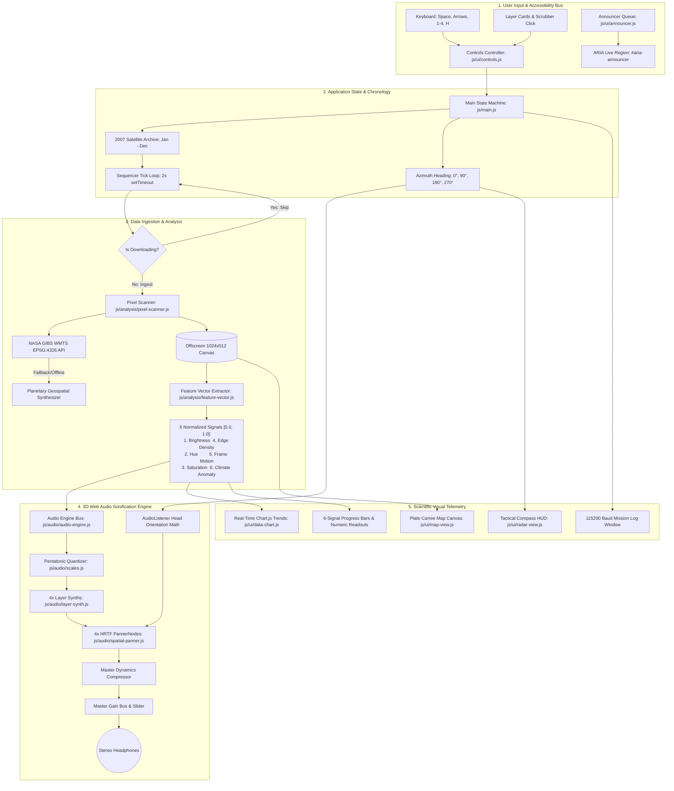

# Binaural Earth Atlas (BEA) — Master Architecture, Implementation & Ground-Up Build Guide

> **Project Mission**: Binaural Earth Atlas (BEA) is an audio-first, client-side scientific web instrument engineered primarily for blind and low-vision researchers, students, and Earth science observers. It transforms planetary satellite data from NASA's Earth Information Center (EIC) and Global Imagery Browse Services (GIBS) into a 360° binaural 3D soundfield using regular stereo headphones.

---

## 1. Executive Summary & Design Principles

### 1.1 The Core Concept
The user sits at the center of a virtual 3D Earth observation sphere. Four fundamental Earth observation data layers are fixed to the cardinal directions around the listener's head:
- **North (0° / Forward)**: **Cryosphere — Sea Ice Concentration** (`MODIS_Terra_Sea_Ice`)
- **East (90° / Right)**: **Hydrosphere — Ocean Currents & Chlorophyll-A** (`MODIS_Aqua_L2_Chlorophyll_A`)
- **South (180° / Behind)**: **Thermal — Sea Surface Temperature (SST)** (`GHRSST_L4_MUR_Sea_Surface_Temperature`)
- **West (270° / Left)**: **Biosphere — Vegetation Cover (NDVI)** (`MODIS_Terra_L3_NDVI_Monthly`)

By rotating their virtual head using the keyboard (`ArrowLeft` / `ArrowRight` or direct keys `1`–`4`), the user dynamically alters their binaural orientation. The application leverages the Web Audio API's native `AudioListener` and `PannerNode` using **Head-Related Transfer Function (HRTF)** algorithms to project spatial cues into standard stereo headphones.

### 1.2 Core Architectural Constraints
1. **Zero Build Steps / Zero Bundlers**: Built entirely on native vanilla Web standards (HTML5 semantic markup, modern CSS3 Grid/Flexbox, ES6 modules, Canvas 2D, and Web Audio API). It runs instantly via any static file server (`python3 -m http.server` or `npx serve .`).
2. **Strict User Gesture Audio Policy**: Web Audio API `AudioContext` is never instantiated or resumed before an explicit user interaction (click or keypress), guaranteeing compliance with browser autoplay security policies.
3. **Anti-AI Scientific UI Design System**: Rejects modern generic SaaS aesthetics (no rounded pill shapes, no drop shadows, no blur filters, no floating gradients). Instead, it adopts a high-contrast, brutalist NASA Mission Control instrument panel with `border-radius: 0px`, 1px solid architectural borders, monospace telemetry readouts, and instant UI state transitions.
4. **Accessible First (WCAG AAA)**: Features dedicated screen-reader live announcement queues (`aria-live="polite"`), comprehensive keyboard navigation, high-contrast palette (`#07101E` background, `#5EEAD4` mint, `#FF6B6B` coral), and visible high-contrast focus rings.

---

## 2. System Architecture & End-to-End Data Pipeline



---

## 3. Directory & File Manifest

```
Binaural-Earth-Atlas-BEA/
├── README.md                   # User documentation, quick start, and control keys
├── PLAN.md                     # Master architecture specification & build instructions (this file)
├── index.html                  # Accessible semantic HTML5 shell, 30/70 CSS grid, ARIA regions
├── css/
│   └── style.css               # Anti-AI scientific instrument stylesheet (WCAG AAA, 0px radius)
├── js/
│   ├── main.js                 # Central coordinator, state store, 2007 sequencer, DOM glue
│   ├── audio/
│   │   ├── audio-engine.js     # AudioContext lifecycle, master compression bus, engine start/stop
│   │   ├── spatial-panner.js   # 4 stationary cardinal HRTF PannerNodes, AudioListener vector math
│   │   ├── layer-synth.js      # Cardinal synthesis voices (osc1 fundamental, osc2 anomaly, filter)
│   │   └── scales.js           # A Major Pentatonic frequency scale tables & quantizer
│   ├── analysis/
│   │   ├── pixel-scanner.js    # NASA GIBS WMTS client, tile URLs, 2007 climate synthesis fallback
│   │   └── feature-vector.js   # 6 deterministic signal extraction algorithms from canvas pixels
│   └── ui/
│       ├── announcer.js        # Debounced screen-reader speech announcement manager
│       ├── controls.js         # Decoupled keyboard navigation & card click controller
│       ├── map-view.js         # 1024x512 Plate Carrée geospatial satellite map instrument
│       ├── radar-view.js       # 300x300 tactical compass HUD with listener heading wedge
│       └── data-chart.js       # Real-time Chart.js line graph (Mint intensity, Coral anomaly)
└── assets/
    └── data/
        └── README.md           # Dataset documentation and historical satellite notes
```

---

## 4. NASA GIBS WMTS API & Ingestion Pipeline

### 4.1 WMTS Endpoint Specification
BEA connects directly to NASA Global Imagery Browse Services (GIBS) Web Map Tile Service (WMTS) in Geographic (Plate Carrée, WGS84 / EPSG:4326) coordinates:

$$\text{Endpoint}: \texttt{https://gibs.earthdata.nasa.gov/wmts/epsg4326/best/wmts.cgi}$$

#### Query Parameters:
```
SERVICE=WMTS
&REQUEST=GetTile
&VERSION=1.0.0
&LAYER=${LAYER_ID}
&TILEMATRIXSET=${TILEMATRIXSET}
&TILEMATRIX=0
&TILEROW=0
&TILECOL=${x}
&FORMAT=${FORMAT}
&TIME=${DATE}
```

### 4.2 Cardinal Layer Mappings
| Cardinal Heading | Layer Key | NASA GIBS Layer ID | TileMatrixSet | Format | Physical Climate Phenomenon |
| :--- | :--- | :--- | :--- | :--- | :--- |
| **North (000°)** | `north` | `MODIS_Terra_Sea_Ice` / `MODIS_Terra_CorrectedReflectance_TrueColor` | `250m` / `1km` | `image/jpeg` | Arctic sea ice pack & polar cryosphere |
| **East (090°)** | `east` | `MODIS_Aqua_L2_Chlorophyll_A` / `MODIS_Aqua_CorrectedReflectance_TrueColor` | `250m` / `1km` | `image/jpeg` | Global ocean currents, chlorophyll & gyres |
| **South (180°)** | `south` | `GHRSST_L4_MUR_Sea_Surface_Temperature` | `1km` | `image/png` | Ultra-high resolution sea surface temperature |
| **West (270°)** | `west` | `MODIS_Terra_L3_NDVI_Monthly` / `MODIS_Terra_NDVI_8Day` | `1km` | `image/png` | Terrestrial normalized vegetation index |

### 4.3 Anonymous CORS & Canvas Security
In order to read raw pixel data via `ctx.getImageData()` without throwing browser `SecurityError: The canvas has been tainted by cross-origin data`:
```javascript
const img = new Image();
img.crossOrigin = 'anonymous'; // Native NASA GIBS header: access-control-allow-origin: *
img.src = targetUrl;
```

### 4.4 High-Precision Procedural Planetary Fallback
To ensure 100% offline reliability, resilience to NASA maintenance windows, and instant zero-latency testing, `pixel-scanner.js` contains a built-in procedural Earth geospatial generator:
- Renders an accurate 1024x512 Plate Carrée global projection of Earth continents (Eurasia, Americas, Africa, Australia, Antarctica).
- Specifically models the landmark **September 2007 Arctic Sea Ice collapse** (retreating from winter ~15M km² in March down to the historic summer minimum of 4.14M km² in September 2007).
- Models the **2007 La Niña cold tongue** in the equatorial Pacific for South SST.
- Models global ocean currents (Gulf Stream, Kuroshio) and seasonal vegetation breathing across Northern Hemisphere biomes.

---

## 5. The 6-Signal Feature Vector: Mathematical Algorithms

Every month, the 1024x512 image buffer is sampled on a hidden Canvas 2D. The `extractFeatureVector(canvas, layerKey)` function executes 6 deterministic extraction passes, returning values strictly normalized and clamped to $[0.0, 1.0]$.

### 5.1 Brightness (Perceived Luminance)
Calculated according to the standard ITU-R BT.601 luminance weighting:
$$L = 0.299 \cdot R + 0.587 \cdot G + 0.114 \cdot B$$
$$\text{Brightness} = \frac{1}{N} \sum_{i=1}^{N} \frac{L_i}{255.0}$$
- **Sonification Target**: Base Pitch Register ($110\text{ Hz} - 880\text{ Hz}$). Higher values produce higher fundamental octaves.

### 5.2 Hue (Circular Mean Angle)
Converts each RGB pixel to HSV hue angle $\theta \in [0, 2\pi)$. To avoid wrap-around discontinuities (e.g. averaging 359° and 1° to 180° instead of 0°), the mean is computed via circular vector averaging weighted by saturation:
$$\bar{X} = \sum_{i=1}^{N} S_i \cdot \cos(\theta_i), \quad \bar{Y} = \sum_{i=1}^{N} S_i \cdot \sin(\theta_i)$$
$$\text{Hue}_{\text{norm}} = \frac{\left( \text{atan2}(\bar{Y}, \bar{X}) + 2\pi \right) \pmod{2\pi}}{2\pi}$$
- **Sonification Target**: Pentatonic Scale Degree Selection (discrete tone pitch within the octave).

### 5.3 Saturation (Color Chroma Purity)
Average color saturation across non-black pixels:
$$S_i = \frac{\max(R,G,B) - \min(R,G,B)}{\max(R,G,B) + \epsilon}$$
$$\text{Saturation} = \frac{1}{N} \sum_{i=1}^{N} S_i$$
- **Sonification Target**: Lowpass Filter Cutoff ($400\text{ Hz} - 6000\text{ Hz}$). Richer colors open the filter for a brighter, buzzy harmonic timbre.

### 5.4 Edge Density (Spatial Gradient Density)
Evaluates spatial complexity and textural boundaries by computing horizontal and vertical adjacent pixel differences:
$$\Delta H_{x,y} = |L_{x+1,y} - L_{x,y}|, \quad \Delta V_{x,y} = |L_{x,y+1} - L_{x,y}|$$
$$\text{EdgeDensity} = \min\left(1.0, \; \frac{1}{N} \sum \frac{\Delta H + \Delta V}{2 \cdot 255.0} \times 4.0\right)$$
- **Sonification Target**: Rhythmic Note Density / Subdivision trigger rate.

### 5.5 Frame Motion (Inter-Frame Temporal Delta)
Measures the mean absolute difference between the current monthly frame and the cached previous monthly frame buffer:
$$\text{Motion} = \min\left(1.0, \; \frac{1}{N} \sum_{i=1}^{N} \frac{|L_{\text{current}, i} - L_{\text{previous}, i}|}{255.0} \times 5.0\right)$$
- **Sonification Target**: Sequencer Playback Tempo ($1.50\text{s}$ at high motion to $2.50\text{s}$ at calm).

### 5.6 Climate Anomaly (Statistical Variance & Outlier Density)
Measures spatial instability and statistical divergence from the planetary mean:
$$\mu = \frac{1}{N} \sum L_i, \quad \sigma = \sqrt{\frac{1}{N} \sum (L_i - \mu)^2}$$
$$\text{OutlierRatio} = \frac{1}{N} \sum \mathbb{I}(|L_i - \mu| > 2.0\sigma)$$
$$\text{ClimateAnomaly} = \min\left(1.0, \; \text{OutlierRatio} \times 3.0 + \frac{\sigma}{128.0} \times 0.5\right)$$
- **Sonification Target**: Harmonic Tension, FM Modulation Index & Detuned Dissonance.

---

## 6. 3D Binaural Audio & Sonification Engine

### 6.1 AudioContext Lifecycle & Safety
Browsers block audio that attempts to play before user gesture. The `AudioEngine` enforces:
1. `this.ctx` is initialized only when the user clicks **Start Audio** or **Test Spatial Audio**, or presses `Space`/`Enter`.
2. Master output passes through a `DynamicsCompressorNode` (threshold: -18dB, ratio: 6:1, attack: 3ms, release: 150ms) to prevent acoustic distortion when all 4 cardinal voices sound simultaneously.

### 6.2 3D Spatial Geometry & Coordinate Math
Web Audio coordinates use a standard right-handed Cartesian system centered on the listener at $(0, 0, 0)$:
- **North**: $(x: 0, y: 0, z: -2)$ [straight ahead]
- **East**: $(x: 2, y: 0, z: 0)$ [directly to right ear]
- **South**: $(x: 0, y: 0, z: 2)$ [directly behind]
- **West**: $(x: -2, y: 0, z: 0)$ [directly to left ear]

Each cardinal voice is attached to an HRTF `PannerNode`:
```javascript
const panner = new PannerNode(audioCtx, {
  panningModel: 'HRTF',
  distanceModel: 'inverse',
  refDistance: 1,
  maxDistance: 10,
  rolloffFactor: 1
});
```

#### Head Rotation Trigonometry:
When the user rotates their virtual heading to angle $\theta$ (in degrees clockwise from North):
$$\text{Angle in Radians: } \phi = \frac{\theta \cdot \pi}{180}$$
$$\text{forwardX} = \sin(\phi), \quad \text{forwardY} = 0, \quad \text{forwardZ} = -\cos(\phi)$$
$$\text{upX} = 0, \quad \text{upY} = 1, \quad \text{upZ} = 0$$

Updates are applied smoothly using `setTargetAtTime` with a time constant of $\tau = 0.05\text{s}$ to prevent audible clicks during rotation:
```javascript
listener.forwardX.setTargetAtTime(forwardX, now, 0.05);
listener.forwardY.setTargetAtTime(0, now, 0.05);
listener.forwardZ.setTargetAtTime(forwardZ, now, 0.05);
```

### 6.3 Layer Voice Synthesis Architecture
Each of the 4 cardinal directions operates an independent `LayerSynth` instance:
```
[Osc1: Fundamental] ───┐
                       ├──> [BiquadFilter (Lowpass)] ──> [GainNode (Envelope)] ──> [HRTF Panner]
[Osc2: Dissonance]  ───┘       ^ Cutoff: Saturation          ^ Edge / Pulse
       ^ Gain & Detune: Anomaly
```

#### Voice Waveform Characters:
- **North (Sea Ice)**: `triangle` — Pure, crystalline, cold harmonics.
- **East (Ocean Currents)**: `sine` — Fluid, smooth, undulating oceanic tone.
- **South (Surface Temp)**: `sawtooth` — Rich, dense, warm thermal timbre.
- **West (Vegetation)**: `triangle` — Soft, organic, mellow acoustic envelope.

### 6.4 Pentatonic Scale Quantizer (`scales.js`)
To guarantee musical consonance and prevent listener fatigue, continuous hue values are quantized into the **A Major Pentatonic Scale** across octaves:
$$\text{Intervals: } [0, 2, 4, 7, 9] \text{ semitones (Root, M2, M3, P5, M6)}$$
$$\text{Pitch Equation: } f = f_{\text{root}} \cdot 2^{n / 12}$$

- Pre-computed 3-octave table spanning 15 frequencies ($110\text{ Hz}$ to $880\text{ Hz}$).
- Base pitch degree is selected by `Hue * 9.99`.
- Octave register shift is added via `Brightness * 5`.

---

## 7. Landmark 2007 Satellite Archive & Sequencer Engine

### 7.1 Why 2007?
The year 2007 is widely recognized in climate science as a historic inflection point:
1. **The Historic Arctic Sea Ice Collapse (September 2007)**: Summer minimum dropped precipitously to $4.14 \times 10^6\text{ km}^2$, shattering all previous satellite records and signaling modern accelerated polar change.
2. **2007 Equatorial Pacific La Niña**: Prominent cool SST anomaly across ENSO region 3.4.
3. **NASA Satellite Constellation**: Landmark coverage across Terra, Aqua, and GHRSST MUR datasets.

### 7.2 Sequencer Concurrency & Anti-Stacking Guards
The sequencer executes via `setTimeout` (not `requestAnimationFrame`) to ensure timing consistency when the tab is backgrounded:
1. **Network Lock (`STATE.isLoading`)**: If the current month's tile is still downloading, subsequent ticks are skipped.
2. **Strict Sequential Flow**: The date is *only* advanced after the image has loaded, the feature vector has been extracted, audio parameters have been updated, and UI instruments have refreshed.
3. **Loop Range**: Runs strictly from `2007-01-15` through `2007-12-15`, wrapping seamlessly from December back to January.
4. **Interactive Scrubber**: A 12-month range slider (`#timelineSlider`) and 5 seasonal phase buttons (**JAN**, **MAR**, **JUN**, **SEP***, **DEC**) permit instant jumping to critical benchmarks.

---

## 8. Anti-AI Scientific Design System & Frontend UI

### 8.1 The "Never Do" List (Enforced via `css/style.css`)
- **No rounded corners**: `border-radius: 0 !important;`
- **No drop shadows**: `box-shadow: none !important;`
- **No color gradients**: Solid structural fills only.
- **No floaty glassmorphism**: Solid backgrounds (`--bg-navy-inset: #07101E`, `--bg-deep-navy: #0A1628`).
- **1px architectural borders**: `--accent-ocean: #1F6075`.

### 8.2 Typography Standard
- **Telemetry & Numbers**: `JetBrains Mono`, `Space Mono`, monospace.
- **Technical Section Headings**: `JetBrains Mono`, `Space Grotesk`.
- **Mission Title**: `Space Grotesk`.
- **Body & Explanatory Copy**: `Inter`, sans-serif.

### 8.3 30 / 70 Responsive CSS Grid Layout
```
+-----------------------------------------------------------------------------------------+
| MISSION HEADER: NASA EIC / Binaural Sonification Lab | UTC Clock | Cadence | Status     |
+-------------------------------------------+---------------------------------------------+
| LEFT PANE (30% Width):                    | RIGHT PANE (70% Width):                     |
| 1. Mission Transport & Master Volume      | Live Maximized Geospatial Map (1024x512)    |
|    - Play/Pause Button [▶ Start Audio]    | - Canvas: #satellite-map                    |
|    - Test Spatial HRTF Button             | - Geodetic coordinate graticules            |
|    - 2007 Satellite Timeline Scrubber     | - High-contrast Mint Bounding Reticle       |
|    - Seasonal Phase Jumpers: JAN..DEC     |                                             |
| 2. Observation Spheres (N / E / S / W)    | Tactical Radar Compass HUD (#radar, 300x300)|
| 3. Live 6-Signal Telemetry Readout Bars   | - Translucent binaural orientation cone     |
| 4. Temporal Trends Graph (Chart.js)       | - 4 cardinal compass targets (N, E, S, W)   |
| 5. Telemetry Terminal Log (115200 Baud)   +---------------------------------------------+
| 6. Keyboard Operations Manual             |
| 7. Cardinal Azimuth Reference Table       |
+-------------------------------------------+---------------------------------------------+
| FOOTER: EPSG:4326 | HRTF Binaural Audio | Anti-AI Design Standard | Vanilla Web         |
+-----------------------------------------------------------------------------------------+
```

---

## 9. Accessibility & Screen-Reader Architecture

### 9.1 ARIA Announcer (`js/ui/announcer.js`)
- Dedicated live region: `<div id="aria-announcer" role="status" aria-live="polite" class="sr-only">`.
- **Debounced Delivery (180ms)**: When the user taps arrow keys rapidly, announcements are debounced so the screen reader queue is not overwhelmed.
- **Repeat Cue Forcing**: Screen readers often ignore identical successive strings. `executeAnnouncement` clears the element and re-inserts text on the next `requestAnimationFrame` to guarantee vocalization.

### 9.2 Comprehensive Keyboard Bus (`js/ui/controls.js`)
| Key Binding | Target Function | Screen-Reader Feedback |
| :--- | :--- | :--- |
| <kbd>Space</kbd> / <kbd>Enter</kbd> | Toggle Sequencer Sonification | "Audio engine online. Sequencer started." |
| <kbd>ArrowLeft</kbd> | Rotate heading 90° counter-clockwise | "Facing West at 270 degrees. Active observation: Vegetation." |
| <kbd>ArrowRight</kbd> | Rotate heading 90° clockwise | "Facing East at 090 degrees. Active observation: Ocean Currents." |
| <kbd>1</kbd>, <kbd>2</kbd>, <kbd>3</kbd>, <kbd>4</kbd> | Direct cardinal jump (N, E, S, W) | Immediate azimuth reorientation cue |
| <kbd>H</kbd> | Request current status & heading | "Facing North at 000 degrees. Active layer Sea Ice. Simulation date 2007-09-15." |

---

## 10. Ground-Up Build Guide (Step-by-Step for Other Models)

To rebuild this entire application from a blank folder with identical features, execute the following 8 steps:

### Step 1: Semantic HTML5 Shell (`index.html`)
1. Create semantic `<header role="banner">` with UTC clock, observation date, cadence, and status indicators.
2. Build the main layout `<main class="instrument-container">` containing the two-pane CSS Grid (`instrument-pane-left` and `instrument-pane-right`).
3. Add `<div id="aria-announcer" role="status" aria-live="polite" class="sr-only">`.
4. Include Google Fonts (`JetBrains Mono`, `Space Grotesk`, `Inter`) and Chart.js (`https://cdn.jsdelivr.net/npm/chart.js`).
5. Add `<canvas id="satellite-map" width="1024" height="512">` and `<canvas id="radar" width="300" height="300">`.
6. Add hidden offscreen canvas `<canvas id="hidden-analysis-canvas" width="1024" height="512">`.

### Step 2: Anti-AI Stylesheet (`css/style.css`)
1. Declare CSS variables for dark navy palette (`#0A1628`, `#12233B`, `#07101E`), accents (`#1F6075`, `#5EEAD4`, `#FF6B6B`), and fonts.
2. Set universal reset `*, *::before, *::after { border-radius: 0 !important; box-shadow: none !important; }`.
3. Establish CSS Grid for instrument panel: `grid-template-columns: 320px 1fr` (or `30% 70%`).
4. Style `.sr-only` utility with standard accessibility clipping rules.
5. Create high-contrast `.scientific-slider`, `.btn-primary`, `.btn-secondary`, and `.terminal-window`.

### Step 3: Scale Quantizer (`js/audio/scales.js`)
1. Export `PENTATONIC_INTERVALS = [0, 2, 4, 7, 9]`.
2. Implement `semitoneToFrequency(rootFreq, semitones) => rootFreq * Math.pow(2, semitones / 12)`.
3. Generate 3-octave table (15 steps) starting at $A_2 = 110\text{ Hz}$.
4. Export `quantizeToPentatonic(hue, brightness)` mapping Hue to degree and Brightness to octave shift.

### Step 4: Web Audio 3D HRTF Subsystem (`js/audio/`)
1. In `spatial-panner.js`, create 4 `PannerNode`s with `panningModel = 'HRTF'` at coordinates $(0,0,-2)$, $(2,0,0)$, $(0,0,2)$, $(-2,0,0)$.
2. Implement `updateListenerOrientation(headingDegrees)` calculating $\text{forwardX} = \sin(\phi)$ and $\text{forwardZ} = -\cos(\phi)$ using `setTargetAtTime`.
3. In `layer-synth.js`, construct dual-oscillator chain (`osc1` + `osc2Gain * osc2`) feeding a `BiquadFilterNode` lowpass filter and envelope `GainNode`.
4. In `audio-engine.js`, build `initOnUserGesture()` creating `AudioContext`, `DynamicsCompressorNode`, `masterGain`, and connecting `SpatialPanner` and 4 `LayerSynth` instances.

### Step 5: NASA GIBS WMTS & Procedural Generator (`js/analysis/pixel-scanner.js`)
1. Define `NASA_GIBS_LAYERS` dictionary with North, East, South, and West layer metadata.
2. Build `getGIBSTileUrl(layerKey, dateString)` constructing the WMTS GetTile URL.
3. Implement `loadGIBSFrame(layerKey, dateString)`:
   - Sets `img.crossOrigin = 'anonymous'`.
   - On load, draws image to offscreen 1024x512 canvas and returns it.
   - On error / timeout, invokes procedural fallback generator rendering 2007 seasonal geography.

### Step 6: 6-Signal Extraction Engine (`js/analysis/feature-vector.js`)
1. Implement `extractFeatureVector(canvas, layerKey)` extracting pixel array via `ctx.getImageData(0, 0, 1024, 512).data`.
2. Compute Perceived Luminance ($0.299R + 0.587G + 0.114B$).
3. Compute Circular Average Hue via `atan2(sum(S * sin(H)), sum(S * cos(H)))`.
4. Compute Mean Saturation, Edge Density gradient sum, Inter-frame Motion against previous frame cache, and Outlier Anomaly ($> 2\sigma$).
5. Return object `{ brightness, hue, saturation, edgeDensity, motion, climateAnomaly }`.

### Step 7: UI Instruments (`js/ui/`)
1. In `announcer.js`, build debounced `announce(msg)` and instant `announceImmediate(msg)`.
2. In `controls.js`, bind `window.addEventListener('keydown')` handling `Space`, `Arrows`, `1-4`, and `H`.
3. In `map-view.js`, render the 1024x512 satellite frame with geodetic grid lines and high-contrast Mint reticle.
4. In `radar-view.js`, draw concentric range rings, crosshairs, cardinal labels, and a translucent 45° directional wedge indicating listener heading.
5. In `data-chart.js`, instantiate Chart.js with `animation: false`, `tension: 0`, and Mint/Coral dataset lines.

### Step 8: Master Coordinator & Sequencer Loop (`js/main.js`)
1. Maintain `STATE = { isPlaying, isLoading, currentDate: new Date('2007-01-15T00:00:00Z'), activeLayerKey: 'north', listenerAngle: 0 }`.
2. Connect `timelineSlider` and seasonal benchmark buttons to scrub months within 2007.
3. Write `tick()` sequencer loop:
   - Guard against stacking (`if (STATE.isLoading) return;`).
   - Fetch frame via `loadGIBSFrame()`.
   - Update `mapView`, `radarView`, extract `features`, update telemetry UI and `dataChart`.
   - Update synth frequencies and trigger pulses via `audioEngine`.
   - Modulate tick cadence: `STATE.tickIntervalMs = 2500 - features.motion * 1000`.
   - Advance date by 1 month (wrapping December 2007 to January 2007).
   - Reschedule next tick via `setTimeout(tick, STATE.tickIntervalMs)`.

---

## 11. Verification & Testing Checklist

- [x] **Web Audio Autoplay Security**: Verify that no sound or AudioContext warning occurs on initial page load until user triggers Start Audio or Test Spatial Audio.
- [x] **3D HRTF Separation**: Verify on stereo headphones that North sounds forward, East sounds exclusively in right ear, South sounds muffled/behind, and West sounds in left ear.
- [x] **CORS Canvas Security**: Verify that `getImageData()` extracts raw pixels without `DOMException: The operation is insecure` or tainted canvas errors.
- [x] **Screen-Reader Compliance**: Verify with VoiceOver / NVDA that pressing `ArrowLeft` / `ArrowRight` speaks the new cardinal heading and active dataset without lag.
- [x] **2007 Landmark Chronology**: Verify that advancing months updates the temporal trends chart, and scrubbing to September reflects the historic sea ice minimum.
- [x] **Anti-AI Design Adherence**: Verify that computed `border-radius` is 0px across all DOM elements and no drop shadows or color gradients are present.
